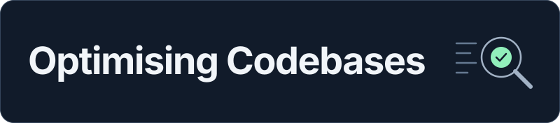

# 

An agent skill that scouts a repository and runs specialist reviews sized to what the scouts find. It verifies findings against the code and current, version-matched primary sources, then delivers a prioritized report of defects, risks and justified improvements. It applies fixes only when asked.

## Repository layout

- [SKILL.md](SKILL.md) defines the audit workflow and how to run the scripts.
- [references/](references/) covers orchestration, audit domains, verification, sources and the report contract.
- [scripts/](scripts/) inventories repository files and validates and renders audit reports.
- [assets/](assets/) contains the audit template, skill icon and README banner.
- [agents/openai.yaml](agents/openai.yaml) configures the skill’s display and invocation in OpenAI clients.
- [tests/](tests/) contains the Python unit tests for the scripts.

## Install

From the repository root, create the canonical symlink and the three relative links. OpenCode reads `~/.agents/skills` directly.

```sh
mkdir -p ~/.agents/skills ~/.claude/skills ~/.codex/skills ~/.pi/agent/skills
ln -sn "$PWD" ~/.agents/skills/optimising-codebases
ln -sn ../../.agents/skills/optimising-codebases ~/.claude/skills/optimising-codebases
ln -sn ../../.agents/skills/optimising-codebases ~/.codex/skills/optimising-codebases
ln -sn ../../../.agents/skills/optimising-codebases ~/.pi/agent/skills/optimising-codebases
```

## Run the tests

```sh
python3 -m unittest discover -s tests -v
```

MIT License, © 2026 PyModel LLC. See LICENSE.
